  

  
  
  
  
  
  

I run Shadowtrace Solution out of Mumbai. Clients come to us for pentests, DPDP compliance and hosting, and the rest of the time I build our own products. Most of that is backend and server work. The fun part is Rust Samrajya, my game server, where I get to test anti-cheat and DDoS ideas on real players.

### What I'm building

<table>
<tr>
<td width="50%"></td>
<td width="50%"></td>
</tr>
<tr>
<td width="50%"></td>
<td width="50%"></td>
</tr>
<tr>
<td width="50%"></td>
<td width="50%"></td>
</tr>
<tr>
<td width="50%"></td>
<td width="50%"></td>
</tr>
</table>

Open source here: the [PC Part Hunt scraper](https://github.com/Yashkute1/pph-scraper-v2), the [leaderboard](https://github.com/Yashkute1/rust-stats-leaderboard), the [skins crawler](https://github.com/Yashkute1/RustLabs-Skins-Crawler) and the [Notion to Discord bot](https://github.com/Yashkute1/rust-samrajya-notion-discord-devlog).

### Security

  

This is how my own systems are protected. The web side keeps the origin hidden behind Cloudflare and lets the database enforce which restaurant can see which rows, so a bug in the API can't leak another tenant's bills. On the game side, Kavach throws away spoofed packets before the kernel even allocates memory for them, and ShadowTrace AC handles the players who get through legitimately and then cheat.

For client work and practice I use Burp Suite, Metasploit, Wireshark and Hashcat. I harden servers with nftables, ufw and WireGuard.

### Stack

**Languages** 

**Apps and data** 

**Servers and cloud** 

Also: Fastify, Kysely, Playwright, Caddy, eBPF/XDP, nftables, WireGuard, Carbon and Oxide plugins, ESC/POS receipt printers.

### Activity

<picture>
  <source media="(prefers-color-scheme: dark)" srcset="https://raw.githubusercontent.com/Yashkute1/Yashkute1/output/snake-dark.svg">
  <source media="(prefers-color-scheme: light)" srcset="https://raw.githubusercontent.com/Yashkute1/Yashkute1/output/snake.svg">
  
</picture>
