  

  
  
  
  
  

I run Shadowtrace Solution out of India. We do security, hosting and DPDP compliance work, and we build our own products on top of that. Most of my time goes into backends and Linux servers. What is left goes into Samrajya, my Rust game server, and keeping cheaters and DDoS traffic off it.

### What I'm building

<table>
<tr>
<td width="50%"></td>
<td width="50%"></td>
</tr>
<tr>
<td width="50%"></td>
<td width="50%"></td>
</tr>
<tr>
<td width="50%"></td>
<td width="50%"></td>
</tr>
</table>

The scraper behind PC Part Hunt is public: [pph-scraper-v2](https://github.com/Yashkute1/pph-scraper-v2). So is the [Notion to Discord devlog bot](https://github.com/Yashkute1/rust-samrajya-notion-discord-devlog).

### Security

  

### Stack

  

### Activity

<picture>
  <source media="(prefers-color-scheme: dark)" srcset="https://raw.githubusercontent.com/Yashkute1/Yashkute1/output/snake-dark.svg">
  <source media="(prefers-color-scheme: light)" srcset="https://raw.githubusercontent.com/Yashkute1/Yashkute1/output/snake.svg">
  
</picture>
